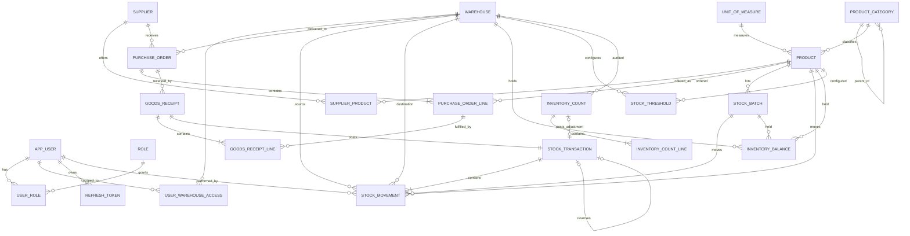

# Warehouse & Supply Management System — Architecture

> Status: **DRAFT, awaiting approval**. No code is written until this document is approved.
> Base package used below: `com.anbar.wms` (a placeholder you can rename).

---

## A. System architecture

### A.1 Style: a modular monolith

The system is a single deployable Spring Boot application, split into **feature modules** with enforced boundaries. The modules are catalog, warehouse, supplier, purchasing, inventory, counting, reporting, alerting and identity.

Why not microservices: inventory, purchasing and counting must change stock **atomically in one ACID transaction**. Splitting them across services would force sagas and eventual consistency onto the most integrity-critical part of the domain. A modular monolith keeps one PostgreSQL transaction per business command. Clean module boundaries keep a future split possible if it is ever needed.

```
                ┌──────────────────────────── Spring Boot application ─────────────────────────────┐
 HTTP/JSON ───► │ Security filter chain (JWT) ─► Controllers (REST, DTOs, validation)               │
                │                                     │                                             │
                │                                     ▼                                             │
                │          Application services (@Transactional use cases, authorization)           │
                │      ┌──────────┬───────────┬────────────┬────────────┬───────────┬──────────┐    │
                │      │ catalog  │ warehouse │ purchasing │ counting   │ reporting │ alerting │    │
                │      └────┬─────┴─────┬─────┴──────┬─────┴─────┬──────┴─────┬─────┴────┬─────┘    │
                │           │           │            ▼           ▼            │          │          │
                │           │           │   ┌─────────────────────────────┐   │          │          │
                │           │           │   │ inventory: InventoryPosting │◄──┘ (read)   │          │
                │           │           │   │ Service = THE ONLY writer   │              │          │
                │           │           │   │ of stock                    │              │          │
                │           │           │   └─────────────┬───────────────┘              │          │
                │           ▼           ▼                 ▼                              ▼          │
                │                  Repositories (Spring Data JPA + targeted native SQL)             │
                └───────────────────────────────────────┬──────────────────────────────────────────┘
                                                        ▼
                         PostgreSQL 16+ (Flyway-managed schema, constraints, triggers)
```

### A.2 Core principles

1. **One stock writer.** Only `InventoryPostingService` in the `inventory` module can create stock movements or change balances. Purchasing (receipts), counting (adjustments) and the inventory endpoints (issue, transfer, write-off) all call it. No other code path touches `inventory_balance`.
2. **Ledger plus projection.** `stock_movement` is an append-only, immutable ledger and the source of truth. `inventory_balance` is a projection of that ledger, updated **in the same database transaction** as the movement insert. A reconciliation job proves that the two always agree.
3. **Defense in depth for integrity.** Each rule is enforced in the service layer (clear error messages), then by database constraints and triggers (an absolute guarantee), then by database privileges (the app role cannot `UPDATE` or `DELETE` ledger rows).
4. **No stock fields on master data.** `Product` and `Warehouse` have no quantity columns, and their DTOs have none either. Stock is read only through the read-only `/inventory/balances` endpoints.
5. **Stateless API.** The API uses JWT access tokens and keeps no server sessions, so it scales horizontally behind a load balancer.

---

## B. Entity list and responsibilities

| Module | Entity | Responsibility |
|---|---|---|
| identity | `User` | An account with credentials (BCrypt hash), status, failed-login counter and lock time. |
| identity | `Role` | A named role: `ADMIN`, `WAREHOUSE_MANAGER`, `USER`. The security stage reduced the original six roles to these three (migration V9). The role names in the endpoint tables below predate that change; [SECURITY.md](SECURITY.md) has the current mapping. |
| identity | `UserWarehouseAccess` | Scopes a user to the warehouses they may operate on. Admins are unscoped. |
| identity | `RefreshToken` | A hashed refresh token with its expiry, revocation state and rotation chain (`replaced_by`). |
| catalog | `UnitOfMeasure` | The unit (PCS, KG, L, M…) and its **allowed decimal scale** (PCS = 0, KG = 3). |
| catalog | `ProductCategory` | A hierarchical category (self-referencing `parent`). |
| catalog | `Product` | SKU, name, barcode, category, base UoM, `batchTracked` and `expiryTracked` flags, and active flag. **Has no quantity.** |
| warehouse | `Warehouse` | Code, name, address, status (`ACTIVE`, `INACTIVE`). **Has no quantity.** |
| warehouse | `StockThreshold` | The minimum (reorder point) and maximum quantity per (warehouse, product). Drives low-stock alerts. |
| supplier | `Supplier` | Legal name, tax ID (VÖEN), contacts, payment terms, active flag. |
| supplier | `SupplierProduct` | Supplier SKU, last price, lead time in days, and preferred flag per (supplier, product). |
| purchasing | `PurchaseOrder` | The PO header: number, supplier, destination warehouse, status, currency, expected date and `@Version`. |
| purchasing | `PurchaseOrderLine` | Product, ordered quantity, unit price and **received quantity** (updated only by receipts). |
| purchasing | `GoodsReceipt` | One delivery received against a PO, with its receipt number and who received it. |
| purchasing | `GoodsReceiptLine` | PO line, batch and quantity received. Links to the stock transaction it posted. |
| inventory | `StockBatch` | A lot: product, batch number, manufacturing date and **expiry date**. Created on receipt. |
| inventory | `StockTransaction` | **Immutable** document header: number, type, reason, reference (PO receipt, count…), user, timestamp, idempotency key and `reversal_of`. Groups the lines that are posted atomically. |
| inventory | `StockMovement` | **Immutable** ledger line: type, product, batch, quantity (> 0), source warehouse, destination warehouse, the balance after the move for each side, user and timestamp. |
| inventory | `InventoryBalance` | **Projection**: quantity on hand per (warehouse, product, batch). Never written through JPA. |
| counting | `InventoryCount` | A physical count session for a warehouse: scope (full warehouse or a product list), status, blind flag, counter and approver. |
| counting | `InventoryCountLine` | Product, batch, system quantity snapshot, counted quantity and variance. |
| alerting | `Alert` | A low-stock, expiring-soon or expired alert with severity, status (`OPEN`, `ACKNOWLEDGED`, `RESOLVED`) and an optional link to a warehouse, product or batch. |
| common | `BaseEntity` / `AuditableEntity` | `id`, `version`, `createdAt`, `createdBy`, `updatedAt`, `updatedBy` via Spring Data auditing. Ledger entities do **not** extend the mutable base. |

---

## C. Database design (PostgreSQL)

### C.1 Conventions

- **Keys.** Primary keys are `BIGINT` from sequences (Hibernate `pooled` optimizer, so batch inserts work). Business identifiers are separate unique columns: `sku`, `warehouse.code`, `po_number`, `transaction_number`.
- **Time.** Every timestamp is `TIMESTAMPTZ` stored in UTC.
- **Quantities** are `NUMERIC(19,4)` mapped to `BigDecimal`. Each product's UoM sets the allowed scale, which the service layer validates.
- **Money** is `NUMERIC(19,4)` plus an ISO-4217 `currency CHAR(3)`.
- **Names.** Columns use snake_case and tables use singular nouns. Every FK column is indexed.
- **No hard deletes of master data.** Master data is deactivated (`active = false`). FKs use `ON DELETE RESTRICT`.
- **Enums** are stored as `VARCHAR` with a `CHECK` constraint, not as PG enum types, because those are painful to change through Flyway.

### C.2 Entity relationship diagram



### C.3 JPA relationship mapping

| Relationship | Mapping | Notes |
|---|---|---|
| Product → Category, UoM | `@ManyToOne(fetch = LAZY)` | Every `@ManyToOne` is LAZY. EAGER is banned project-wide. |
| Category → parent | `@ManyToOne` self-reference | Cycles are prevented in the service layer. |
| PurchaseOrder ↔ PurchaseOrderLine | `@OneToMany(mappedBy, cascade = ALL, orphanRemoval = true)` | This is an aggregate: lines are only modified through the PO, and only while it is `DRAFT`. |
| GoodsReceipt ↔ GoodsReceiptLine | `@OneToMany(cascade = PERSIST)` | Immutable after creation. |
| GoodsReceipt → StockTransaction | `@OneToOne` (FK on goods_receipt) | One receipt posts exactly one stock transaction. |
| StockTransaction ↔ StockMovement | `@OneToMany(cascade = PERSIST)` | Insert only. Both are `@Immutable`. |
| StockMovement → Product, Batch, Warehouse ×2, User | `@ManyToOne(LAZY)` | Source and destination are two separate FKs to `warehouse`. |
| InventoryCount ↔ Lines | `@OneToMany(cascade = ALL)` | Lines are editable only while the count is `IN_PROGRESS`. |
| User ↔ Role | `@ManyToMany` through `user_role` | Small and stable, so a plain join table is enough. |
| Supplier ↔ Product | An explicit `SupplierProduct` entity, **not** `@ManyToMany` | The link carries attributes (price, lead time). |

Bidirectional mappings are used only inside an aggregate. Everything else is unidirectional `@ManyToOne` plus repository queries, which avoids huge collections and N+1 queries.

### C.4 Key tables (abridged DDL for the critical part)

> The schema is now implemented as Flyway migrations. [DATABASE.md](DATABASE.md) describes the final schema and
> lists where it deliberately differs from this draft (e.g. no `reference_type`/`reference_id` on transactions).

```sql
CREATE TABLE stock_batch (
    id               BIGINT PRIMARY KEY,
    product_id       BIGINT NOT NULL REFERENCES product(id),
    batch_number     VARCHAR(64) NOT NULL,
    manufactured_on  DATE,
    expires_on       DATE,
    supplier_id      BIGINT REFERENCES supplier(id),
    created_at       TIMESTAMPTZ NOT NULL DEFAULT now(),
    CONSTRAINT uq_batch UNIQUE (product_id, batch_number),
    CONSTRAINT ck_batch_dates CHECK (expires_on IS NULL OR manufactured_on IS NULL OR expires_on > manufactured_on)
);

CREATE TABLE stock_transaction (
    id                  BIGINT PRIMARY KEY,
    transaction_number  VARCHAR(32) NOT NULL UNIQUE,          -- e.g. TRF-2026-000123
    type                VARCHAR(32) NOT NULL,                 -- RECEIPT, ISSUE, TRANSFER, ...
    reason              VARCHAR(500),
    reference_type      VARCHAR(32),                          -- GOODS_RECEIPT, INVENTORY_COUNT, ...
    reference_id        BIGINT,
    reversal_of_id      BIGINT UNIQUE REFERENCES stock_transaction(id),  -- at most one reversal each
    idempotency_key     VARCHAR(100) UNIQUE,
    performed_by        BIGINT NOT NULL REFERENCES app_user(id),
    performed_at        TIMESTAMPTZ NOT NULL DEFAULT now()
);

CREATE TABLE stock_movement (
    id                         BIGINT PRIMARY KEY,
    transaction_id             BIGINT NOT NULL REFERENCES stock_transaction(id),
    line_no                    INT NOT NULL,
    movement_type              VARCHAR(32) NOT NULL,
    product_id                 BIGINT NOT NULL REFERENCES product(id),
    batch_id                   BIGINT REFERENCES stock_batch(id),
    quantity                   NUMERIC(19,4) NOT NULL CHECK (quantity > 0),
    source_warehouse_id        BIGINT REFERENCES warehouse(id),
    destination_warehouse_id   BIGINT REFERENCES warehouse(id),
    source_balance_after       NUMERIC(19,4),     -- snapshot used by the stock card / audit
    destination_balance_after  NUMERIC(19,4),
    unit_cost                  NUMERIC(19,4),
    performed_by               BIGINT NOT NULL REFERENCES app_user(id),
    performed_at               TIMESTAMPTZ NOT NULL,
    CONSTRAINT uq_movement_line UNIQUE (transaction_id, line_no),
    CONSTRAINT ck_movement_endpoints CHECK (
        (movement_type IN ('RECEIPT','OPENING_BALANCE','ADJUSTMENT_IN')
            AND source_warehouse_id IS NULL AND destination_warehouse_id IS NOT NULL)
     OR (movement_type IN ('ISSUE','WRITE_OFF','RETURN_TO_SUPPLIER','ADJUSTMENT_OUT')
            AND source_warehouse_id IS NOT NULL AND destination_warehouse_id IS NULL)
     OR (movement_type = 'TRANSFER'
            AND source_warehouse_id IS NOT NULL AND destination_warehouse_id IS NOT NULL
            AND source_warehouse_id <> destination_warehouse_id)
     OR (movement_type = 'REVERSAL'
            AND num_nonnulls(source_warehouse_id, destination_warehouse_id) >= 1)
    )
);
CREATE INDEX ix_mv_src  ON stock_movement (source_warehouse_id, product_id, performed_at);
CREATE INDEX ix_mv_dst  ON stock_movement (destination_warehouse_id, product_id, performed_at);
CREATE INDEX ix_mv_time ON stock_movement (performed_at);

CREATE TABLE inventory_balance (
    id            BIGINT PRIMARY KEY,
    warehouse_id  BIGINT NOT NULL REFERENCES warehouse(id),
    product_id    BIGINT NOT NULL REFERENCES product(id),
    batch_id      BIGINT REFERENCES stock_batch(id),
    quantity      NUMERIC(19,4) NOT NULL DEFAULT 0,
    version       BIGINT NOT NULL DEFAULT 0,
    updated_at    TIMESTAMPTZ NOT NULL DEFAULT now(),
    CONSTRAINT ck_balance_non_negative CHECK (quantity >= 0),          -- last line of defense
    CONSTRAINT uq_balance UNIQUE NULLS NOT DISTINCT (warehouse_id, product_id, batch_id)  -- PG15+
);

-- Immutability: the ledger can never be changed, even by a buggy service.
CREATE FUNCTION forbid_modification() RETURNS trigger AS $$
BEGIN RAISE EXCEPTION 'Table % is append-only', TG_TABLE_NAME; END $$ LANGUAGE plpgsql;
CREATE TRIGGER trg_stock_movement_immutable BEFORE UPDATE OR DELETE ON stock_movement
    FOR EACH ROW EXECUTE FUNCTION forbid_modification();
CREATE TRIGGER trg_stock_transaction_immutable BEFORE UPDATE OR DELETE ON stock_transaction
    FOR EACH ROW EXECUTE FUNCTION forbid_modification();
-- Plus: the runtime role wms_app gets only INSERT, SELECT on these tables (Flyway runs as wms_owner).
```

Remaining tables, by column groups:

- `app_user` (`username` UNIQUE, `email` UNIQUE, `password_hash`, `status`, `failed_attempts`, `locked_until`), `role`, `user_role`, `user_warehouse_access`, and `refresh_token` (`token_hash` UNIQUE, `expires_at`, `revoked_at`, `replaced_by_id`).
- `unit_of_measure` (`code` UNIQUE, `scale`), `product_category` (`parent_id`, `name`, unique per parent), and `product` (`sku` UNIQUE, `barcode` UNIQUE, `uom_id`, `category_id`, `batch_tracked`, `expiry_tracked`, `active`). Invariant: `expiry_tracked ⇒ batch_tracked`.
- `warehouse` (`code` UNIQUE, `status`) and `stock_threshold` (UNIQUE `(warehouse_id, product_id)`, `min_qty ≥ 0`, `max_qty ≥ min_qty`).
- `supplier` (`tax_id` UNIQUE) and `supplier_product` (UNIQUE `(supplier_id, product_id)`).
- `purchase_order` (`po_number` UNIQUE, `status`, `version`), `purchase_order_line` (UNIQUE `(po_id, product_id)`, `ordered_qty > 0`, `received_qty ≥ 0`, `received_qty ≤ ordered_qty × (1 + tolerance)`), `goods_receipt`, and `goods_receipt_line`.
- `inventory_count` (`status`, `scope`, `version`) and `inventory_count_line` (UNIQUE `(count_id, product_id, batch_id)`). A partial unique index allows only one active count per warehouse with full scope.
- `alert` (`type`, `status`, `dedup_key` UNIQUE WHERE `status <> 'RESOLVED'`, so the same alert is never duplicated).
- Hibernate Envers `*_aud` tables for master data and POs, and a `shedlock` table.

---

## D. Package structure (package-by-feature, layered inside)

```
com.anbar.wms
├── WmsApplication.java
├── common/                         # shared kernel, depends on nothing else
│   ├── config/                     # JpaAuditingConfig, OpenApiConfig, JacksonConfig, ClockConfig
│   ├── entity/                     # BaseEntity, AuditableEntity
│   ├── exception/                  # BusinessException, ErrorCode, NotFoundException,
│   │                               # ConflictException, GlobalExceptionHandler (RFC 9457 ProblemDetail)
│   ├── web/                        # PageResponse, sorting whitelist, IdempotencyKey resolver, CorrelationIdFilter
│   ├── validation/                 # custom constraints (@ValidQuantity, @Sku …)
│   └── util/
├── security/                       # cross-cutting technical module
│   ├── config/                     # SecurityFilterChain, PasswordEncoder, CORS, method security
│   ├── jwt/                        # JwtService (JJWT), JwtAuthenticationFilter, JwtProperties
│   ├── CurrentUserProvider.java    # resolves the acting user for movements and auditing
│   └── WarehouseAccessEvaluator.java  # @PreAuthorize("@warehouseAccess.canOperate(#warehouseId)")
├── identity/                       # users, roles, login, refresh tokens
│   ├── controller/  service/  repository/  entity/  dto/  mapper/
├── catalog/                        # products, categories, units of measure
│   ├── controller/  service/  repository/  entity/  dto/  mapper/
├── warehouse/                      # warehouses, thresholds
├── supplier/                       # suppliers, supplier-products
├── purchasing/                     # purchase orders, goods receipts
├── inventory/                      # the core
│   ├── controller/                 # InventoryCommandController, BalanceQueryController, MovementQueryController
│   ├── service/
│   │   ├── InventoryPostingService.java   # THE single writer of stock (public API of the module)
│   │   ├── PostingCommand.java            # immutable record describing a transaction to post
│   │   ├── BalanceWriter.java             # native atomic UPDATE/UPSERT with lock ordering
│   │   ├── BatchService.java
│   │   └── ReconciliationService.java
│   ├── repository/  entity/  dto/  mapper/
│   └── event/                      # StockPostedEvent (published after commit)
├── counting/                       # inventory audits
├── alerting/                       # expiry and low-stock schedulers, alert management
└── reporting/                      # read-only queries, projections, no entities of its own
    ├── controller/  service/  query/  dto/
```

Dependency rules, enforced by **ArchUnit** tests that fail the build:

- `controller → service → repository → entity`. Controllers never touch repositories or entities; they exchange DTOs only.
- Modules call each other only through another module's **service** classes, never its repositories.
- `common` depends on nothing, and `security` depends only on `common` and `identity`.
- Only `inventory.service` may reference `InventoryBalance` writes or `StockMovement` constructors.
- `reporting` is read-only. Its services are all `@Transactional(readOnly = true)`.

---

## E. API endpoint plan (`/api/v1`)

Common behaviour:

- JSON only. List endpoints are paginated (`page`, `size` ≤ 100, `sort` from a whitelist) and return `PageResponse<T>`.
- Errors use `application/problem+json` (RFC 9457) with a stable `code` field, for example `INSUFFICIENT_STOCK`.
- Every stock-changing `POST` **requires** an `Idempotency-Key` header.
- Updates require the entity `version` (optimistic locking). A stale version gets `409 Conflict`.

### Auth and users

| Method | Path | Role | Purpose |
|---|---|---|---|
| POST | `/auth/login` | public | Returns an access token (15 min) and a refresh token (7 days). |
| POST | `/auth/refresh` | public | Rotates the refresh token. Reuse of an old token revokes the whole chain. |
| POST | `/auth/logout` | auth | Revokes the refresh token. |
| GET | `/users/me` | auth | Current user profile and roles. |
| GET/POST | `/users`, `/users/{id}` | ADMIN | Manage users. |
| PUT | `/users/{id}/roles`, `/users/{id}/warehouses` | ADMIN | Assign roles and warehouse scope. |
| PATCH | `/users/{id}/status` | ADMIN | Lock, unlock or deactivate. |

### Master data

| Method | Path | Role (write) |
|---|---|---|
| GET/POST/PUT | `/units-of-measure` | ADMIN |
| GET/POST/PUT | `/categories`, `/categories/{id}` (tree via `?parentId`) | ADMIN, MANAGER |
| GET/POST/PUT | `/products`, `/products/{id}`, `PATCH /products/{id}/status` | ADMIN, MANAGER |
| GET/POST/PUT | `/warehouses`, `/warehouses/{id}`, `PATCH /warehouses/{id}/status` | ADMIN |
| GET/PUT | `/warehouses/{id}/thresholds` | MANAGER |
| GET/POST/PUT | `/suppliers`, `/suppliers/{id}`, `PATCH /suppliers/{id}/status` | PURCHASER, MANAGER |
| GET/POST/PUT/DELETE | `/suppliers/{id}/products` | PURCHASER |

> None of the product or warehouse request DTOs contain a quantity field. Unknown JSON properties are **rejected** (`FAIL_ON_UNKNOWN_PROPERTIES = true`), so `{"quantity": 100}` sent to a product endpoint fails with 400 instead of being silently ignored.

### Inventory: commands (the only way to change stock)

| Method | Path | Role | Effect |
|---|---|---|---|
| POST | `/inventory/issues` | STOREKEEPER | Outbound stock, multi-line. Batch is optional (FEFO auto-allocation) or explicit. |
| POST | `/inventory/transfers` | STOREKEEPER (both warehouses in scope) | Atomic −source / +destination, multi-line. |
| POST | `/inventory/write-offs` | MANAGER | Expired or damaged stock. Requires a reason code. |
| POST | `/inventory/receipts` | MANAGER | Unplanned (non-PO) receipt, such as a customer return. Requires a reason. |
| POST | `/inventory/opening-balances` | ADMIN | Initial load. Allowed only if no movements exist yet for that (warehouse, product). |
| POST | `/stock-transactions/{id}/reversal` | MANAGER | Compensating transaction. The original is never edited. |

Receipts from POs go through `/purchase-orders/{id}/receipts`, and adjustments only come from count approval.

### Inventory: queries (read-only)

| Method | Path | Purpose |
|---|---|---|
| GET | `/inventory/balances?warehouseId&productId&batchId&categoryId&nonZero` | Stock on hand. |
| GET | `/warehouses/{id}/stock`, `/products/{id}/stock` | Convenience views. |
| GET | `/stock-transactions`, `/stock-transactions/{id}` | Documents with their lines. |
| GET | `/stock-movements?warehouseId&productId&type&from&to&userId` | Ledger search. |
| GET | `/batches?productId&expiringBefore`, `/batches/{id}` | Lots and expiry. |

### Purchasing

| Method | Path | Role | Notes |
|---|---|---|---|
| GET/POST | `/purchase-orders` | PURCHASER | Created in `DRAFT`. |
| GET/PUT | `/purchase-orders/{id}` | PURCHASER | Editable in `DRAFT` only. |
| POST | `/purchase-orders/{id}/submit` | PURCHASER | `DRAFT → SUBMITTED` |
| POST | `/purchase-orders/{id}/approve` | MANAGER (≠ creator) | `SUBMITTED → APPROVED` |
| POST | `/purchase-orders/{id}/reject` | MANAGER | `SUBMITTED → DRAFT`, with a comment. |
| POST | `/purchase-orders/{id}/cancel` | PURCHASER, MANAGER | Only if nothing has been received yet. |
| POST | `/purchase-orders/{id}/receipts` | STOREKEEPER | Partial or full receipt, posts a `RECEIPT` transaction. Idempotent. |
| GET | `/purchase-orders/{id}/receipts` | — | Receipt history. |
| POST | `/purchase-orders/{id}/close` | MANAGER | Short-close a partially received PO. |
| POST | `/suppliers/{id}/returns` | STOREKEEPER | `RETURN_TO_SUPPLIER` movement, referencing the receipt. |

### Inventory counts (audits)

| Method | Path | Role | Notes |
|---|---|---|---|
| POST | `/inventory-counts` | MANAGER, AUDITOR | Create a count (full warehouse or a product list) in `DRAFT`. |
| POST | `/inventory-counts/{id}/start` | MANAGER, AUDITOR | Snapshots system quantities and **freezes the scope**. |
| PUT | `/inventory-counts/{id}/lines` | AUDITOR, STOREKEEPER | Enter counted quantities. Blind counts hide the system quantity. |
| POST | `/inventory-counts/{id}/submit` | AUDITOR | Every line must have a count. |
| POST | `/inventory-counts/{id}/approve` | MANAGER (≠ counter) | Posts `ADJUSTMENT_IN/OUT` and unfreezes. |
| POST | `/inventory-counts/{id}/cancel` | MANAGER | Unfreezes without posting anything. |
| GET | `/inventory-counts`, `/{id}`, `/{id}/variance` | — | |

### Alerts and reports

| Method | Path | Purpose |
|---|---|---|
| GET | `/alerts?type&status&warehouseId`, `POST /alerts/{id}/acknowledge` | Alert inbox. |
| GET | `/reports/stock-on-hand?warehouseId&categoryId` | Current stock. |
| GET | `/reports/stock-card?warehouseId&productId&from&to` | Opening balance, movements with running balance, closing balance. |
| GET | `/reports/stock-as-of?date&warehouseId` | Historical balance, derived from the ledger. |
| GET | `/reports/movement-summary?from&to&groupBy=type\|warehouse\|product` | Totals by period. |
| GET | `/reports/low-stock?warehouseId` | Balance below the threshold minimum. |
| GET | `/reports/expiring?withinDays=30&warehouseId` | Expiring and expired lots. |
| GET | `/reports/inventory-valuation?warehouseId&asOf` | Quantity × cost. |
| GET | `/reports/supplier-performance?from&to` | On-time delivery rate, average lead time, fill rate. |
| GET | `/reports/count-variance?from&to&warehouseId` | Audit results. |
| GET | `/reports/purchase-orders?status&supplierId&from&to` | PO pipeline. |

Reports return JSON. CSV export (`Accept: text/csv`) is planned for stage 8.

---

## F. Critical business rules and edge cases

### F.1 Stock integrity (non-negotiable)

| # | Rule | Enforced by |
|---|---|---|
| R1 | Stock is never negative for any (warehouse, product, batch). | A conditional atomic `UPDATE … WHERE quantity >= :qty`, plus `CHECK (quantity >= 0)`. |
| R2 | Stock changes **only** through `InventoryPostingService`. | Module design, ArchUnit tests, and no quantity in master-data DTOs. |
| R3 | Movements and transactions are immutable: no update and no delete, ever. | `@Immutable` entities without setters, insert-only repositories, DB triggers and DB grants. |
| R4 | Corrections are made only with a `REVERSAL` transaction that references the original. At most one reversal per transaction, and a reversal cannot itself be reversed. | Service check plus `UNIQUE (reversal_of_id)`. |
| R5 | A reversal of an inbound movement fails if the stock has already been consumed (it would go negative). | R1 |
| R6 | Every movement records its type, quantity > 0, product, source/destination per type, user (from the JWT, **never** from the request body) and a server timestamp (from an injected `Clock`, never the client). | `CHECK` constraints and `CurrentUserProvider`. |
| R7 | A transfer is one transaction with one line per product/batch. Source and destination change together or not at all. | A single `@Transactional` posting. |
| R8 | A transfer needs source ≠ destination, both warehouses `ACTIVE`, and the user scoped to both. | Service check plus `CHECK`. |
| R9 | `balance(w,p,b) = Σ inbound qty − Σ outbound qty` over the ledger, always. | A reconciliation job, plus a test after every concurrency test. |
| R10 | Multi-line documents are all-or-nothing. If one line fails, nothing is posted, and the error lists every failing line. | Transaction rollback. |
| R11 | Repeating a request with the same `Idempotency-Key` returns the original result instead of posting twice. A different payload under the same key returns 422. | `UNIQUE (idempotency_key)` plus a payload hash. |

### F.2 Quantities and units

- The quantity's scale must match the product's UoM scale (2.5 PCS is rejected with 400). The upper bound is validated to avoid overflow.
- A batch-tracked product **requires** a batch on inbound movements. On outbound movements the batch is either explicit or FEFO-allocated. Products that are not batch-tracked must have `batch = null`.
- An expiry-tracked product requires `expires_on` on receipt. Receiving an already expired lot is rejected. Receiving a lot that expires within N days produces a warning, or is rejected if configured to.

### F.3 Expiration

- Expired lots **cannot be issued or transferred**. They can only be written off or returned to the supplier.
- FEFO auto-allocation (when no batch is given) consumes the earliest non-expired lots first and may split one requested line into several movements.
- A daily scheduled job (ShedLock, so it runs once per cluster) raises `EXPIRING_SOON` (≤ 30 days, configurable) and `EXPIRED` alerts, deduplicated per batch and warehouse. It **never** writes off automatically; that is a human decision.
- Expiry is compared as a `DATE` in the business timezone (configurable, default `Asia/Baku`).

### F.4 Purchasing

- The PO state machine is `DRAFT → SUBMITTED → APPROVED → PARTIALLY_RECEIVED → RECEIVED → CLOSED`. `CANCELLED` is reachable from `DRAFT`, `SUBMITTED` or `APPROVED` only while `received_qty = 0`. Any other transition returns `409 INVALID_STATE_TRANSITION`.
- Receipts are allowed only on `APPROVED` or `PARTIALLY_RECEIVED` POs, and only for products on the PO.
- The cumulative received quantity is ≤ ordered × (1 + over-receipt tolerance). The tolerance defaults to 0%.
- The status is updated automatically: all lines fully received → `RECEIVED`.
- The supplier must be active when the PO is submitted, and the destination warehouse must be active when stock is received.
- Segregation of duties: the approver cannot be the creator.
- Lines are immutable after `SUBMITTED`. Changing a submitted PO means rejecting it back to `DRAFT`.
- Returns to the supplier are limited to the quantity received from that supplier for the batch, minus earlier returns, and to the stock currently available.

### F.5 Inventory counts

- Starting a count snapshots the system quantities and **freezes** its scope. Any movement touching a frozen (warehouse, product) is rejected with `409 STOCK_FROZEN_FOR_COUNT`. Only one active full count is allowed per warehouse.
- In a blind count, the system quantity is hidden from the counter in the API response.
- On approval, the variance is counted − snapshot. Positive variance posts `ADJUSTMENT_IN` and negative variance posts `ADJUSTMENT_OUT`, in a single transaction that references the count. Lines with zero variance post nothing.
- A product found during the count that the system doesn't know about can be added as a line with snapshot = 0.
- The approver must be different from the counter (configurable).
- Variances above a threshold (for example 5% or an absolute value) require a reason per line.

### F.6 Master data

- SKU, barcode, warehouse code, supplier tax ID and PO number are unique. Uniqueness is case-insensitive where it applies (a unique index on `lower(code)`).
- A product's UoM and `batch_tracked` flag **cannot change once the product has movements**, because that would corrupt history.
- A warehouse cannot be deactivated while it has non-zero stock or open POs or counts. A product cannot be deactivated while it has non-zero stock in any warehouse.
- Inactive products and warehouses can't be used in new documents, but remain visible in history and reports.
- Category cycles are rejected.

### F.7 Security

- Users can only operate on warehouses in their scope. Out-of-scope resources return **404** rather than 403, so their existence isn't revealed.
- After 5 failed logins the account is locked for 15 minutes. Refresh tokens are stored hashed and rotated, and reuse is detected.
- There is no self-elevation of roles, and the last ADMIN cannot be removed.

---

## G. Technical decisions

### G.1 Inventory consistency: ledger plus a synchronous projection

The requirement allows two options: derive balances from movements on every read, or keep a consistent projection. I choose **both**, as follows:

- **Writes.** In a single transaction: `INSERT stock_transaction`, then `INSERT stock_movement` lines, then an atomic `UPDATE` or `UPSERT` of `inventory_balance` per affected (warehouse, product, batch), using `RETURNING quantity` to fill `*_balance_after`. If any step fails, everything rolls back, so the projection can never drift from the ledger through application code.
- **Reads of current stock** are O(1) from `inventory_balance`.
- **Historical reads** ("stock as of date X", stock card) are **derived from the ledger**: `Σ` of movements up to X.
- **Reconciliation.** A nightly job, also runnable on demand by an ADMIN, recomputes `Σ ledger` per key, compares it with `inventory_balance`, and raises a CRITICAL alert on any mismatch. It never auto-corrects. In a correct system, it always finds zero mismatches.
- Why not derive balances on every read: the cost grows with ledger size, and the non-negative check at write time would need `SUM` aggregates under a lock, which is slow and still racy without serializable isolation.
- Why not event sourcing with an async projection: eventual consistency would make "never negative" unenforceable at write time.

### G.2 Concurrency problems and solutions

| # | Problem | Solution |
|---|---|---|
| C1 | **Lost update.** Two issues read qty = 10 and both write qty − 5. | Never read-modify-write in Java. Use a single atomic SQL statement: `UPDATE inventory_balance SET quantity = quantity - :q, version = version + 1 WHERE warehouse_id=:w AND product_id=:p AND batch_id IS NOT DISTINCT FROM :b AND quantity >= :q RETURNING quantity`. Zero rows updated means `InsufficientStockException`. The row lock serializes concurrent writers to the same key, and different keys proceed in parallel. |
| C2 | **Overselling race** on the last units. | Same statement as C1. The `WHERE quantity >= :q` check runs under the row lock, so it is race-free. The `CHECK` constraint is the backstop. |
| C3 | **Lazy creation of a balance row.** The first receipt and a concurrent receipt both try to `INSERT`. | `INSERT … ON CONFLICT (warehouse_id, product_id, batch_id) DO UPDATE SET quantity = inventory_balance.quantity + EXCLUDED.quantity RETURNING quantity`. |
| C4 | **Deadlocks.** Transfer A→B (product X, Y) runs at the same time as B→A (Y, X), or two multi-line documents run in opposite order. | **Canonical lock ordering.** `BalanceWriter` sorts every balance operation in a transaction by `(warehouse_id, product_id, batch_id)` before executing it. All writers lock rows in the same global order, so cycles are impossible. A residual safety net retries on SQLSTATE `40P01` or `40001` (at most 3 times, with jittered backoff); idempotency makes retries safe. |
| C5 | **Double submit or network retry** posts a receipt twice. | `Idempotency-Key` → `UNIQUE (idempotency_key)`. On a duplicate, the stored transaction is returned. |
| C6 | **Concurrent receipts on one PO** exceed the ordered quantity. | `SELECT … FOR UPDATE` on the PO row (`@Lock(PESSIMISTIC_WRITE)`) at the start of the receipt use case, plus the DB `CHECK` on `received_qty`. |
| C7 | **Concurrent state changes**, for example approve and cancel on the same PO, or edits to the same product. | `@Version` optimistic locking → `409 Conflict`. The client reloads and retries. |
| C8 | **Count start racing with movement posting.** A movement checks "not frozen" and the count starts before it commits. | Every posting takes `FOR SHARE` on each affected warehouse row. Count start/approve/cancel take `FOR UPDATE` on the warehouse row. Shared locks don't block each other, so normal throughput is unaffected; only a count start waits for in-flight postings, and vice versa. |
| C9 | **Double reversal.** | `UNIQUE (reversal_of_id)` → `409 ALREADY_REVERSED`. |
| C10 | **Scheduled jobs on N instances** produce duplicate alerts. | ShedLock (a JDBC lock table) plus the `dedup_key` partial unique index. |
| C11 | **Document number gaps or collisions.** | PostgreSQL sequences per document type. Gaps are acceptable and documented; collisions are impossible. |
| C12 | **Inconsistent multi-query reports** (totals don't add up because rows changed between queries). | Reports run in `@Transactional(readOnly = true, isolation = REPEATABLE_READ)`, so they see one snapshot. |
| C13 | **JPA cache going stale** after a native balance update. | `InventoryBalance` is never loaded into the persistence context during a posting. `BalanceWriter` uses native queries only, and the `@Modifying` queries use `clearAutomatically = true`. |

Default isolation is **READ COMMITTED**, with the explicit locking above. That is enough and scales better than SERIALIZABLE everywhere.

### G.3 Transaction boundaries

- **One business command is one database transaction**, opened in the application service (`@Transactional` on public service methods). Controllers, mappers and repositories never open transactions.
- `spring.jpa.open-in-view=false`. DTOs are mapped inside the service transaction, so there is no lazy loading in controllers.

| Use case | Transaction contains |
|---|---|
| Issue, transfer, write-off | Idempotency check → validation → warehouse `FOR SHARE` → transaction and movement inserts → ordered balance updates → commit. |
| PO receipt | PO `FOR UPDATE` → validate lines and tolerance → create or find batches → **call `InventoryPostingService.post()` (joins the same tx, `Propagation.REQUIRED`)** → update `received_qty` → recompute PO status → commit. |
| Count approval | Count `@Version` check → warehouse `FOR UPDATE` → compute variances → post adjustments (same tx) → status `APPROVED` → unfreeze → commit. |
| Reversal | Lock the original transaction (`FOR UPDATE` via `reversal_of` uniqueness) → build mirrored lines → post → commit. |
| Read and report | `readOnly = true` (Hibernate skips dirty checking, and requests can later be routed to a read replica). |
| Side effects (alerts on low stock, notifications) | `@TransactionalEventListener(phase = AFTER_COMMIT)`, so they never run for rolled-back work and never roll back the posting. If external integrations come later, they move to a transactional **outbox** table. |

`InventoryPostingService.post()` is annotated `@Transactional(propagation = MANDATORY)`. It **must** be called inside a caller's transaction, which makes it impossible to accidentally post stock outside the receipt or count transaction.

### G.4 Other decisions

| Decision | Choice | Reason |
|---|---|---|
| Runtime | Java 21 bytecode (builds and runs on JDK 21–25). Pinned in stage 1: Spring Boot 4.1.2 (Spring Framework 7, Hibernate 7.4, Jackson 3.1, Flyway 12.4, JUnit Jupiter 6, Testcontainers 2.0), springdoc 3.2.0, MapStruct 1.6.3, ArchUnit 1.5.1, Maven 3.9.16 via wrapper. | Virtual threads (`spring.threads.virtual.enabled`) are on for I/O-bound request handling. |
| Database | PostgreSQL 16+ | Needs `NULLS NOT DISTINCT` (15+), `ON CONFLICT`, `RETURNING`, row locks and partial indexes. |
| Schema | Flyway only, `ddl-auto=validate` | The schema is reviewed SQL, and Hibernate only validates it. Migrations are forward-only (`V1__baseline.sql`, …). |
| IDs | `BIGINT` sequences plus business codes | Fast joins, batch inserts and readable FKs. |
| Quantities | `BigDecimal` / `NUMERIC(19,4)` | Exact arithmetic. `double` is never used for quantities or money. |
| Mapping | MapStruct (`componentModel = spring`, `unmappedTargetPolicy = ERROR`) | Compile-time mapping. A new field the mapper doesn't handle breaks the build. |
| Validation | Bean Validation on DTOs (syntax) plus domain checks in services (semantics) | Structural errors give 400. Business rule violations give 409 or 422 with a code. |
| Errors | `ProblemDetail` (RFC 9457) and an `ErrorCode` enum | Stable machine-readable codes for clients. |
| Auth | JJWT, HS256 with a 256-bit secret from env/secret store (RS256 if other services verify tokens), 15-minute access token, refresh token rotation | Stateless and revocable through refresh tokens. |
| Authorization | URL rules (coarse) plus `@PreAuthorize` (roles) plus `WarehouseAccessEvaluator` (data scope) | Defense in depth. |
| Auditing | Spring Data auditing (who/when) on all mutable entities, and **Envers** history for product, warehouse, supplier, PO and thresholds | Full change history of master data. The stock ledger is its own audit trail. |
| Time | An injected `java.time.Clock` | Deterministic tests for expiry and timestamps. |
| Query filtering | JPA `Specification`, plus native SQL for heavy reports | Type-safe dynamic filters, and SQL where it matters. |
| API docs | springdoc-openapi, with a JWT bearer scheme and examples | Swagger UI is enabled outside production only. |
| Testing | Unit tests (JUnit 5 + Mockito) for services and rules. **Integration tests on real PostgreSQL via Testcontainers** for repositories, constraints, triggers, locking and the full HTTP flow. Concurrency tests (N threads on the same stock, asserting no negative balance and ledger = balance). ArchUnit for boundaries. | H2 cannot reproduce PostgreSQL locking, `ON CONFLICT` or triggers, so it is not used. |
| Observability | Actuator (health, readiness, liveness), Micrometer to Prometheus, JSON logs with a correlation ID, custom metrics (postings/sec, insufficient-stock count, deadlock retries) | Operability. |
| Packaging | A multi-stage Dockerfile (JRE base, non-root user, layered jar) and `docker-compose` (app + PostgreSQL) | Reproducible environments. |
| Scaling path | Stateless app → N replicas → read replica for reporting → materialized views for heavy reports → monthly partitions of `stock_movement` by `performed_at` once it holds tens of millions of rows | Each step is optional and incremental. |

---

## H. Implementation roadmap (8 stages)

Each stage ends with green tests, an updated OpenAPI spec and a review checkpoint with you.

| Stage | Scope | Done when |
|---|---|---|
| **1. Foundation** | Maven project with pinned versions, profiles (`local`, `test`, `prod`), docker-compose PostgreSQL, Flyway baseline, `common` module (BaseEntity, auditing, `ProblemDetail` handler, ErrorCode, PageResponse, Clock, correlation ID), springdoc, Testcontainers base class, ArchUnit skeleton, health endpoint. | `mvn verify` passes with a Testcontainers context-load test, and Swagger UI loads. |
| **2. Security and identity** | User, Role, warehouse scope, BCrypt, JJWT access and refresh with rotation and reuse detection, login lockout, `SecurityFilterChain`, method security, `CurrentUserProvider`, admin user endpoints, seeded admin via env. | Auth flow integration tests pass: 401/403/404-scope cases, and refresh reuse revokes the chain. |
| **3. Master data** | UoM, categories (tree), products, warehouses, thresholds, suppliers, supplier-products. DTOs, MapStruct, validation, Specifications, paging, `@Version` conflicts, deactivation rules, Envers. | CRUD and rule tests pass, and a stock field in a request is rejected. |
| **4. Inventory core** ⭐ | Batches, `stock_transaction`, `stock_movement`, `inventory_balance` and the immutability triggers and grants. `InventoryPostingService` and `BalanceWriter` (atomic SQL, lock ordering, deadlock retry), idempotency, issue, transfer, write-off, unplanned receipt, opening balance, reversal, balance and movement queries. | Unit tests and **concurrency tests** pass (e.g. 50 threads issuing on 10 units: exactly 10 succeed, the balance is 0, ledger = balance, and opposite-direction transfers don't deadlock). |
| **5. Purchasing** | PO aggregate and state machine, approval with segregation of duties, goods receipts (partial, tolerance, batch creation, expiry validation) posting through the inventory module, short-close, supplier returns. | End-to-end test (PO → approve → 2 partial receipts → RECEIVED) passes, and concurrent receipts can't over-receive. |
| **6. Inventory counts** | Count lifecycle, scope freeze with warehouse locking, blind mode, variance, approval → adjustments, variance reasons. | A movement during a count is rejected, approval posts the correct adjustments, and the counter can't approve their own count. |
| **7. Expiry, alerts and reports** | FEFO allocation, expiry and low-stock scheduler with ShedLock and deduplication, alert inbox, all report endpoints (stock card and as-of derived from the ledger), reconciliation job and admin trigger. | Report correctness tests on seeded scenarios pass, and reconciliation reports 0 mismatches after the full test suite. |
| **8. Hardening and delivery** | Multi-stage Dockerfile, full compose stack, Actuator, Prometheus metrics and JSON logging, rate limiting on `/auth/*`, CSV export, index review with `EXPLAIN ANALYZE` on large seeded data, security review (OWASP API Top 10), README and runbook. | The image builds and runs, there are no high findings, and the main queries meet their latency targets (e.g. p95 < 100 ms at 1M movements). |

---

## Open questions for your approval

Defaults are in **bold**. If you are happy with them, just say "approved".

1. **Transfers.** Use an **atomic single-step transfer** (stock leaves A and arrives at B instantly)? The alternative is two-step (`TRANSFER_OUT` → *in-transit* → `TRANSFER_IN` on confirmation), which is more realistic when shipments take days.
2. **Quantities.** Use **decimal quantities with a per-UoM scale**? The alternative is integer pieces only.
3. **Costing.** Store **unit cost on receipt movements and value inventory at the latest receipt cost**? The alternative is weighted-average or FIFO costing (more complex, best done as its own stage).
4. **Bin locations** inside warehouses (shelf, rack): **out of scope for now**, but the design can add a `location` dimension to the balance key later.
5. **Tenancy.** A **single organization**? Multi-tenant SaaS would add `tenant_id` everywhere and should be decided now.
6. **Locale.** **API messages in English with stable error codes** (a client can localize them into Azerbaijani)? The alternative is localized `messages_az.properties` from the start.
