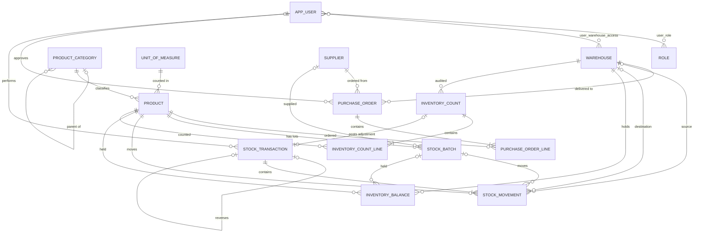

# Database design

This describes the schema created by the Flyway migrations in `src/main/resources/db/migration`.
It implements section C of [ARCHITECTURE.md](ARCHITECTURE.md). Where the two differ, this file and the
migrations are authoritative (see "Changes from the architecture draft" at the end).

## Migrations

| Version | Module | Tables |
|---|---|---|
| V1 | shared | `forbid_modification()` trigger function, default privileges for the app role |
| V2 | identity | `role` (seeded), `app_user`, `user_role` |
| V3 | catalog | `unit_of_measure` (seeded), `product_category`, `product` |
| V4 | warehouse | `warehouse`, `user_warehouse_access` |
| V5 | supplier | `supplier` |
| V6 | purchasing | `purchase_order`, `purchase_order_line` |
| V7 | inventory | `stock_batch`, `stock_transaction`, `stock_movement`, `inventory_balance` |
| V8 | counting | `inventory_count`, `inventory_count_line` |
| V9 | identity | Replaces the seeded roles with `ADMIN`, `WAREHOUSE_MANAGER`, `USER` (security stage) |
| V10 | catalog, warehouse | Product `min_stock_quantity`, `purchase_price`, `selling_price`; warehouse `description` |
| V11 | inventory, supplier | Movement types renamed to INBOUND/OUTBOUND/ADJUSTMENT; `stock_transaction.reference_number` and `supplier_id`; movement and supplier number sequences; `supplier.description` |
| V12 | purchasing, inventory, audit | `goods_receipt` (idempotent receipts); PO `rejection_reason`, line `notes`, number sequences; batch `unit_cost` and `purchase_order_line_id`; `inventory_balance.total_received` (backfilled from the ledger, `quantity <= total_received`); `inventory_count*` renamed to `inventory_audit` / `inventory_audit_item` with the new statuses and completion columns |
| V13 | importing, reporting | `stock_import` (idempotent CSV bulk imports: `idempotency_key` unique, the full result kept as JSON); `ix_stock_transaction_actor_time` for the stock-movement-by-user report |

Migrations are forward-only. A released migration is never edited; changes go into a new `V<n>__*.sql`.
Hibernate runs with `ddl-auto=validate`, so the application refuses to start if an entity and the schema disagree.

Tables from later stages are not created yet: refresh tokens (security), supplier price lists, stock thresholds and alerts (alerting), and the ShedLock table.

## Relationships

### Identity

- **User ↔ Role** is many-to-many through `user_role`. Roles are seeded reference data (`ADMIN`,
  `WAREHOUSE_MANAGER`, `USER` since V9) and the application only reads them.
- **User ↔ Warehouse** is many-to-many through `user_warehouse_access`. It is the data scope: a non-admin user
  may only operate on the listed warehouses.
- Users are never deleted, because the ledger references them forever. Accounts are disabled instead
  (`status = 'DISABLED'`). Temporary lockout after failed logins uses `locked_until`, so it expires on its own.
- Usernames and emails are stored lower-case, with a `CHECK` constraint. That makes plain `UNIQUE` constraints
  case-insensitive and lets lookups use the index.

### Catalog

- **Product → Category** and **Product → Unit of measure** are mandatory many-to-one relationships.
- **Category → parent** is an optional self-reference that forms a tree. Sibling names are unique ignoring case.
  A category can't be its own parent. Longer cycles are rejected in the service layer.
- `unit_of_measure.decimal_scale` (0–4) is how many decimals a quantity in that unit may have. Quantities are
  stored as `NUMERIC(19,4)` everywhere.
- `expiry_tracked` implies `batch_tracked`, enforced by a `CHECK`, because expiry dates live on batches.
- **Products and warehouses have no quantity column.** Stock exists only in the inventory tables.

### Purchasing

- **Purchase order → Supplier, Warehouse** are mandatory. One order delivers into one warehouse.
- **Purchase order → Lines** is one-to-many, owned by the order (the aggregate root). Each line has a
  `line_no`, and there is at most one line per product.
- The order total is computed from its lines, never stored, so it can't drift from them.
- Status rules in the database:
  - An approved order, and every status after approval, must have an approver and approval time.
  - A cancelled order must have a reason.
  - `received_quantity` must stay between 0 and `ordered_quantity`.
- **Goods receipt → Purchase order, Stock transaction** are mandatory. `idempotency_key` is unique, so a retried
  request can never receive twice; each receipt points at exactly one INBOUND transaction (unique too).
- **Stock batch → Purchase order line** is optional and records which order line created the batch, with its
  `unit_cost`.

### Inventory: ledger and balances

- **Stock batch → Product** is mandatory. `(product_id, batch_number)` is unique. The same batch can sit in
  several warehouses.
- **Stock transaction → Movements** is one-to-many. A transaction is one posted document (receipt, issue,
  transfer…) whose lines were applied atomically.
- **Stock movement → Warehouse** has two optional many-to-one links, `source_warehouse_id` and
  `destination_warehouse_id`. `ck_stock_movement_endpoints` fixes which one each movement type uses:
  - RECEIPT, OPENING_BALANCE, ADJUSTMENT_IN: destination only.
  - ISSUE, WRITE_OFF, RETURN_TO_SUPPLIER, ADJUSTMENT_OUT: source only.
  - TRANSFER: both, and they must be different warehouses.
- **Stock transaction → reversed transaction** is an optional self-reference. It is set exactly when the type is
  `REVERSAL`. `UNIQUE (reversal_of_id)` makes double reversal impossible.
- **Inventory balance** is the projection: one row per (warehouse, product, batch). `total_received` sums
  everything that ever entered the row (the batch's initial quantity in that warehouse); `quantity <= total_received`. Products without batches use
  `batch_id = NULL`. `UNIQUE NULLS NOT DISTINCT` (PostgreSQL 15+) keeps that key unique too.
- Documents point at their stock transaction, not the other way around. `inventory_audit.adjustment_transaction_id`
  and `goods_receipt.stock_transaction_id` do this. The ledger therefore has no loosely typed
  `reference_type`/`reference_id` columns that no foreign key could check.

### Inventory audits

- **Audit → Warehouse** is mandatory, and **Audit → Items** is one-to-many, owned by the audit (`inventory_audit`,
  `inventory_audit_item`; renamed from `inventory_count*` in V12).
- Each item stores the expected quantity (the system balance when the item was counted) and the counted quantity.
  `discrepancy` is a **generated column** (`counted − expected`), so it can never disagree with them.
- The lifecycle is recorded as (who, when) pairs: started, submitted, approved, completed. `CHECK` constraints
  require the pairs that each status implies, and only a COMPLETED audit may reference its adjustment transaction.
- At most one full audit can be open (IN_PROGRESS, PENDING_APPROVAL, APPROVED) per warehouse (a partial unique index).

## How the database prevents invalid states

| Rule | Mechanism |
|---|---|
| Stock never negative | `CHECK (quantity >= 0)` on `inventory_balance`; non-negative `*_balance_after` on movements |
| Movement quantity positive | `CHECK (quantity > 0)` |
| A movement's batch belongs to its product | Composite FK `(batch_id, product_id) → stock_batch (id, product_id)`, also on balances and count lines |
| A movement's user and time equal its transaction's | Composite FK `(transaction_id, performed_by, performed_at) → stock_transaction (id, performed_by, performed_at)` |
| Movement endpoints match the movement type | `ck_stock_movement_endpoints` |
| Ledger can't be edited or deleted | `BEFORE UPDATE OR DELETE` and `BEFORE TRUNCATE` triggers, for every role including the owner |
| App can't edit the ledger or delete balances | `REVOKE UPDATE, DELETE` on the ledger and `REVOKE DELETE` on `inventory_balance` for the app role |
| App can't change the schema | The app role has no `CREATE` on the schema; Flyway runs as the owner |
| Retried requests can't post twice | `UNIQUE (idempotency_key)` on `stock_transaction` |
| Master data with history can't disappear | `ON DELETE RESTRICT` on every reference to master data; master data is deactivated instead |

Join tables (`user_role`, `user_warehouse_access`) and aggregate children (order lines, count lines) use
`ON DELETE CASCADE`, because they have no meaning without their parent.

## Types and keys

| Data | PostgreSQL type | Java type |
|---|---|---|
| Primary keys | `BIGINT` from a per-table sequence `<table>_seq` (`INCREMENT BY 50`) | `Long` (Hibernate pooled optimizer, batched inserts) |
| Quantities | `NUMERIC(19,4)` | `BigDecimal` |
| Money (prices, costs) | `NUMERIC(19,4)` plus a currency code per order | `BigDecimal`, `java.util.Currency` |
| Timestamps | `TIMESTAMPTZ`, stored in UTC | `Instant` |
| Calendar dates (expiry, order date) | `DATE` | `LocalDate` |
| Enumerations | `VARCHAR` plus a `CHECK` listing the values | Java `enum` with `@Enumerated(STRING)` |
| Codes (ISO currency, country) | `VARCHAR(n)` plus a format `CHECK` | `String` / `Currency` |

Enumerations are `VARCHAR` with a `CHECK` rather than PostgreSQL enum types, because adding a value is then
a simple constraint change in a migration.

## Indexes

Every foreign key column has an index (or is the leading column of a unique constraint), so joins and the
`RESTRICT` checks on delete stay fast. Additional indexes cover the frequent searches:

- `product`: SKU and barcode (unique), and a case-insensitive name prefix (`lower(name) text_pattern_ops`).
- `supplier`: code and tax ID (unique), and the name prefix.
- `purchase_order`: `(status, order_date)` for order lists.
- `stock_movement`: `(source_warehouse_id, product_id, performed_at)` and
  `(destination_warehouse_id, product_id, performed_at)` for stock cards; `(product_id, performed_at)`;
  `performed_at` for period reports.
- `stock_batch`: `expires_on` (partial, non-null only) for expiry reports.
- `inventory_balance`: the unique key `(warehouse_id, product_id, batch_id)`, plus `product_id`.

## JPA mapping rules

- Every `@ManyToOne` and `@OneToOne` is `LAZY`. Nothing is fetched eagerly. Detail views load what they need
  with an entity graph (for example `PurchaseOrderRepository.findWithLinesById`).
- Collections are mapped only inside an aggregate (order → lines, count → lines, transaction → movements, user →
  roles/warehouses). Everything else is queried through repositories, which avoids huge collections and N+1 loads.
- `AuditableEntity` (master data, orders, counts, batches) carries `@Version` optimistic locking plus `created_at`,
  `created_by`, `updated_at` and `updated_by`, filled by Spring Data auditing from the injected `Clock`.
  `created_by` and `updated_by` hold the username. Until the security stage it is `system`.
- `StockTransaction`, `StockMovement` and `InventoryBalance` are `@Immutable`. Their repositories expose no update
  or delete methods (`AppendOnlyRepository`, `ReadOnlyRepository`). Balances are written only by atomic SQL in the
  inventory stage.
- Entities have no public setters. Fields are set through constructors (and later through intention-revealing
  methods in their stages), and entities never appear in API responses (an ArchUnit rule enforces this).

## Changes from the architecture draft

- `stock_transaction` has no `reference_type`/`reference_id`. Documents reference their transaction instead,
  so every link has a real foreign key.
- Added composite foreign keys for "batch belongs to product" and "movement user/time equal the transaction's".
- `inventory_count_line.variance` is a generated column.
- Over-receipt tolerance is fixed at 0% in the schema (`received_quantity <= ordered_quantity`). Allowing a
  tolerance later means changing that constraint in a new migration.
